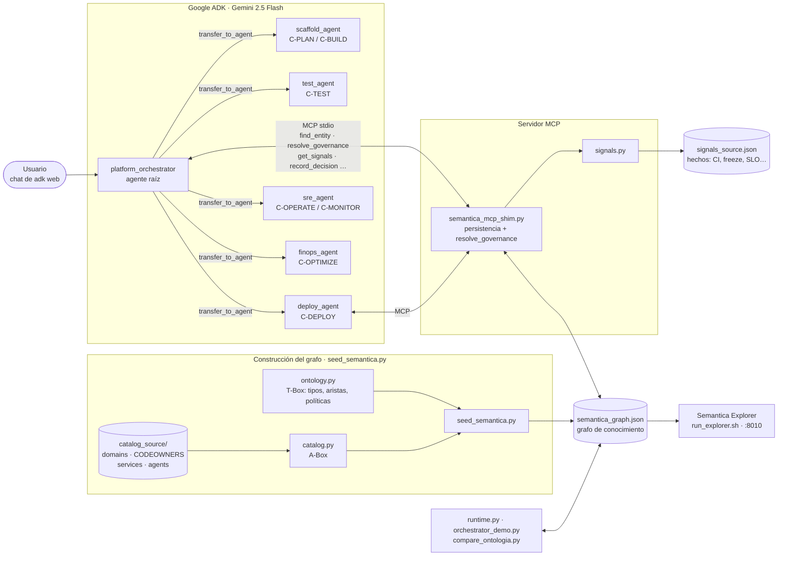

# Metadatos vs. Ontología — Demo con Google ADK + Semántica

[](https://github.com/dyronrh/ontology-agent-adk-semantica-mcp)
[](https://www.youtube.com/@DayronRemigio?sub_confirmation=1)

> ⭐ **¿Te sirve este repo?** Dale una estrella en GitHub: me ayuda a seguir publicando
> ejemplos como este. Y 📺 **suscríbete a mi canal de YouTube
> [@DayronRemigio](https://www.youtube.com/@DayronRemigio?sub_confirmation=1)** para ver
> los videos prácticos donde construyo y explico estas demos paso a paso.

Episodio de **Agent Development Platform**. Un agente orquestador de una plataforma
interna de desarrollo (IDP) toma decisiones apoyándose en la **taxonomía de la empresa**
(por dominios y por capacidades del ciclo de vida de las aplicaciones), consume el
**MCP de Semántica** y deja cada decisión **auditable**. Al final: una prueba A/B
**con ontología vs. sin ontología**.

---

## Contenido

| Archivo | Qué es | Capa |
|---|---|---|
| `ontology.py` | **T-Box**: tipos, vocabulario de aristas, políticas con `APPLIES_TO`, validación. | modelo |
| `catalog.py` | **A-Box**: sincroniza dominios/servicios/agentes desde `catalog_source/`. | hechos |
| `catalog_source/` | Las fuentes de verdad: `domains.yaml`, `CODEOWNERS`, `services/*.yaml`, `agents.yaml`. | hechos |
| `runtime.py` | Orquestador gobernado: consulta gates al grafo y registra decisiones. | ejecución |
| `graph_query.py` | Índice bidireccional + consultas (`owner_domain`, `gates_for`, …). | — |
| `seed_semantica.py` | Compone las tres capas y exporta `semantica_graph.json`. | — |
| `semantica_graph.json` | Grafo exportado (46 nodos, 69 aristas), **sin decisiones**. | — |
| `orchestrator_demo.py` | Una petición resuelta contra el grafo, con cadena causal. | demo |
| `compare_ontologia.py` | Prueba A/B: con ontología vs. sin ontología. | demo |
| `test_ontologia.py` | 30 pruebas de lo que el rediseño afirma. | — |
| `adk_orchestrator.py` | Wiring real en Google ADK. El prompt **ya no recita los gates**. | — |
| `semantica_mcp_shim.py` | MCP con la persistencia arreglada + `resolve_governance`. | — |
| `run_explorer.sh` | Levanta el Semantica Explorer sobre `semantica_graph.json`. | — |
| `.env.example` | Plantilla de variables de entorno (`GOOGLE_API_KEY`). Cópiala a `.env`. | config |
| `DEMO_ADK.md` | **Guion de rodaje de la demo en vivo desde el chat de ADK** (7 golpes). | — |
| `signals.py` + `signals_source.json` | Sirve los hechos que las políticas evalúan. | ejecución |

## Las tres capas

El repo separa tres cosas que antes vivían juntas en un solo script y que tienen
**ciclos de vida distintos**. Ese es el punto de todo el diseño:

| Capa | Qué es | Quién la escribe | Cadencia |
|---|---|---|---|
| **Ontología** (`ontology.py`) | El modelo: qué tipos existen y qué relaciones son legales | Humano, en git, con revisión | Trimestral |
| **Catálogo** (`catalog.py`) | Los hechos de tu empresa hoy | ETL desde el sistema de registro | Horas/días |
| **Decisiones** (`runtime.py`) | Rastro de ejecución, append-only | El agente, en runtime | Por petición |

Consecuencia práctica: **el grafo base no trae ni una decisión**. Las decisiones
que veías antes en el seed eran rastro inventado a mano — el equivalente a
commitear los logs.

---

## Arquitectura



**Flujo de una petición** (*"despliega payments-api a producción"*):

1. El orquestador resuelve el nombre con `find_entity` → `SVC-PAYMENTS-API`.
2. `resolve_governance(service, intent, env)` devuelve capacidad, dominio dueño,
   sub-agente y la **lista ordenada de gates** que aplican en ese entorno.
3. `get_signals` trae los hechos (CI, freeze, SLO, aprobación…) desde `signals_source.json`.
4. Evalúa cada gate; si todos pasan hace **DISPATCH** al sub-agente, si no **BLOCK**.
5. `record_decision` deja la decisión y su cadena causal en el grafo (auditable en el Explorer).

---

## Requisitos

- **Python 3.10+**
- **pip**
- (Opcional, solo para `adk_orchestrator.py`) **Google ADK** y una clave de **Gemini**.

Comprueba tu Python:
```bash
python --version    # o python3 --version
```

---

## Paso a paso (demo principal, sin claves, 100% offline)

### 1. Crea un entorno e instala Semántica
```bash
python -m venv .venv
source .venv/bin/activate          # Windows: .venv\Scripts\activate
pip install --upgrade pip
pip install semantica
```

### 2. Levanta el grafo (ontología + catálogo)
```bash
python seed_semantica.py
```
Salida esperada:
```
CAPA 1/3  ontologia (T-Box) — el modelo
CAPA 2/3  catalogo (A-Box) — sincronizado desde catalog_source/
CAPA 3/3  decisiones — vacio a proposito (las escribe el runtime)
validacion T-Box: OK
OK -> semantica_graph.json  (46 nodos, 69 aristas)
gates para C-DEPLOY en staging : ['POL-OWNERSHIP', 'POL-TESTS', 'POL-SECSCAN']
gates para C-DEPLOY en prod    : ['POL-OWNERSHIP', 'POL-TESTS', 'POL-SLO', 'POL-SECSCAN', 'POL-FREEZE', 'POL-APPROVAL']
```
Esas dos últimas líneas son la demostración: **el mismo deploy pasa por 3 gates
en staging y por 6 en prod**, y eso lo decide el grafo, no el código ni el prompt.
Fíjate también en dónde cae `POL-SLO`: en tercera posición, porque su
`gate_order` es 25. El orden tampoco está en el código.

### 3. Corre la demo del orquestador
```bash
python orchestrator_demo.py                    # camino feliz (prod, 6 gates)
python orchestrator_demo.py --env staging      # mismo código, 3 gates
python orchestrator_demo.py --ci failed        # bloquea en POL-TESTS
python orchestrator_demo.py --requester D-FRONTEND   # bloquea en POL-OWNERSHIP
python orchestrator_demo.py --slo-exhausted    # bloquea en POL-SLO (solo prod)
python orchestrator_demo.py --save             # persiste las decisiones al grafo
```
Resuelve la taxonomía (`intención → capacidad → sub-agente`), **pregunta al grafo
qué gates aplican**, los evalúa en el orden que el grafo diga y deja la cadena
causal. En ese fichero no hay ninguna lista de políticas.

### 3b. Corre las pruebas
```bash
python test_ontologia.py     # 30 ok, 0 fallidas
```

### 4. Corre la prueba A/B (el momento del hook)
```bash
python compare_ontologia.py
```
Marcador esperado:
```
SIN ontologia:  ruteo 4/7 · gobierno 4/7 · auditable 0/7
CON ontologia:  ruteo 7/7 · gobierno 7/7 · auditable 7/7
```

### 5. Explora el grafo en el navegador (Semantica Explorer)
```bash
./run_explorer.sh          # http://127.0.0.1:8010
./run_explorer.sh 8020     # otro puerto, si el 8010 esta ocupado
```
Abre `http://127.0.0.1:<puerto>` y veras el dashboard interactivo: grafo,
tipos de nodo y arista, analitica, decisiones y sus cadenas causales.

El comando crudo equivalente es:
```bash
SEMANTICA_ALLOW_ANONYMOUS=true \
  semantica-explorer --graph semantica_graph.json --host 127.0.0.1 --port 8010
```

> **Por que la variable.** Desde `semantica` 0.6.x todas las rutas `/api/*` del
> Explorer estan protegidas: si no defines `SEMANTICA_API_KEY` devuelven **503** y la
> UI aparece vacia. La UI estatica no envia la cabecera `X-API-Key`, asi que la via
> soportada para uso local es optar explicitamente por acceso anonimo. Hazlo **solo**
> escuchando en `127.0.0.1`. Si necesitas exponerlo en red, define `SEMANTICA_API_KEY`
> y consume la API con `-H "X-API-Key: ..."` en lugar del modo anonimo.

Comprobacion rapida por API:
```bash
curl -s http://127.0.0.1:8010/api/graph/stats     # 46 nodos, 69 aristas
curl -s http://127.0.0.1:8010/api/decisions
```

---

## Cómo grabar la demo (orden sugerido para el video)

1. **Hook:** corre `compare_ontologia.py`, pero muestra primero **solo** la tabla
   "SIN ontología". Señala el caso #2 (`desplegar payments-api` con CI en rojo →
   `DISPATCH`). Ese es tu "código roto a producción".
2. **Teoría:** explica origen de "ontología", metadatos, ontología, por qué se confunden.
3. **Práctica:** `seed_semantica.py` (muestra el grafo con `semantica-explorer`),
   luego `orchestrator_demo.py` (una decisión con su cadena causal).
4. **Payoff:** vuelve a `compare_ontologia.py` completo. Ahora la tabla "CON ontología"
   bloquea el mismo caso (`BLOCK` en `ci_gate`) y lo explica. Cierra el bucle del hook.

### Provocar un bloqueo en vivo
Ya no hace falta editar código — son flags:
```bash
python orchestrator_demo.py --ci failed              # POL-TESTS
python orchestrator_demo.py --requester D-FRONTEND   # POL-OWNERSHIP
python orchestrator_demo.py --freeze --no-approval   # POL-FREEZE + POL-APPROVAL
python orchestrator_demo.py --slo-exhausted          # POL-SLO
```

### El agente explora el grafo por su cuenta

Las 10 herramientas que ve el orquestador se dividen en tres grupos:

| Grupo | Herramientas | Para qué |
|---|---|---|
| **Explorar** | `find_entity`, `list_entities`, `describe_entity` | Resolver "payments-api" → `SVC-PAYMENTS-API`, listar el catálogo, ver todo sobre una entidad en ambas direcciones |
| **Decidir** | `resolve_governance`, `get_signals` | Qué gates aplican y con qué hechos evaluarlos |
| **Recordar** | `record_decision`, `get_causal_chain`, `find_precedents`, `query_decisions`, `get_graph_summary` | Dejar y consultar el rastro |

`find_entity` devuelve un campo **`confidence`** y el agente tiene que respetarlo:

```
payments-api                   high        SVC-PAYMENTS-API
el servicio de pagos           high        SVC-PAYMENTS-API
pagos                          ambiguous   (dominio vs servicio -> pregunta)
quien maneja los despliegues   none        (no es un nombre -> usa list_entities)
```

El scoring pesa cada término por lo raro que sea en el grafo. Sin eso, "el
servicio de pagos" puntuaba igual a `SVC-PAYMENTS-API` que a `INT-SCAFFOLD`,
porque *servicio* aparece en medio catálogo.

> Si el agente te responde **"no tengo acceso a la lista de aplicaciones"** o te
> pide un ID tipo `SVC-...`, es que no está llamando a `find_entity`. El prompt se
> lo prohíbe explícitamente; si insiste, aprieta esa parte de la instrucción.

### Hacer que un despliegue pase o bloquee

El agente evalúa las reglas contra los valores que devuelve `get_signals`, que
salen de [`signals_source.json`](signals_source.json). Ése es el único fichero
que tocas para dirigir una demo. Resolución por capas:

```
defaults  <  environments[env]  <  services[SVC]  <  overrides["SVC@env"]
```

**Bloquear un deploy a prod por freeze:**
```json
"overrides": {
  "SVC-PAYMENTS-API@prod": { "in_freeze_window": true, "approved": false }
}
```

**Bloquear un deploy a prod por SLO** (es lo que el repo trae puesto):
```json
"overrides": {
  "SVC-PAYMENTS-API@prod": { "slo_ok": false }
}
```

**Que pase:** deja `"overrides": {}`.

No hace falta reiniciar nada: el fichero se lee en cada llamada. Ni `adk web`, ni
el shim, ni el seed — las señales no viven en el grafo, por eso son el fichero
que tocas en directo.

Otras tres palancas, de más a menos legítima:

| Quieres | Haz esto | Qué demuestra |
|---|---|---|
| Que pase, sin tocar nada | `--env staging` | `POL-FREEZE` tiene `env_scope: ["prod"]`, así que **ni siquiera aplica**. Es la mejor demo: la ontología decidiendo |
| Que pase en prod | `overrides` vacío en `signals_source.json` | El hecho cambió, la política no |
| Desactivar la política del todo | Quita `"C-DEPLOY"` de su `applies_to` en `ontology.py` y re-corre el seed | La política existe pero deja de gobernar deploys |

Lo que **no** deberías hacer para que pase: cambiar la `expression` a algo que
siempre sea cierto. Eso no es levantar un gate, es fingir que se evaluó.

### Añadir una política en vivo (el mejor momento del video)

`POL-SLO` ya está en el repo — se añadió así, y son **dos ficheros de datos, cero
código**. Para repetirlo en cámara, bórrala, graba y vuelve a añadirla.

**1) La política**, en `POLICIES` de `ontology.py`:
```python
{
    "id": "POL-SLO",
    "name": "SLO Budget Gate",
    "content": "No desplegar con el error budget agotado",
    "gate_order": 25,
    "env_scope": ["prod"],
    "expression": "slo_ok",
    "applies_to": ["C-DEPLOY"],
    "reads": ["SIG-SLO"],
}
```

**2) La señal que la regla lee**, en `SIGNALS` del mismo fichero:
```python
("SIG-SLO", "SLO Error Budget", "Si queda error budget del SLO del servicio"),
```

`reads` tiene que listar lo que lee la **expresión**, no lo que restringe el
scope. Si pones `["SIG-ENV"]` el grafo valida igual y el gate funciona, pero
estás declarando que la política consulta el entorno cuando en realidad consulta
`slo_ok`: la auditoría deja de poder decir de qué hecho salió el bloqueo.

**3) `python seed_semantica.py`.** El gate nuevo aparece **en su posición por
`gate_order`** (tercero, no último) y el agente de ADK lo aplica sin que nadie
edite su prompt.

Si te paras aquí, `orchestrator_demo.py` falla con `PolicyExpressionError`
pidiendo `slo_ok`. **Ese error es la funcionalidad**: una política declarada cuyo
hecho nadie sirve no se salta, se detiene. Es fail-closed, y es un buen plano.

**4) El valor**, en `defaults` de `signals_source.json`:
```json
"slo_ok": true
```
Ahora despacha, con 6 gates. Ponlo en `false` en `overrides` para el bloqueo
quirúrgico, y repite la petición **a staging**: pasa, porque `env_scope` deja a
`POL-SLO` fuera. Mismo hecho, dos veredictos, y quien decide es el grafo.

### Tres cosas que ADK hace y que rompen el gobierno

Verificadas en ADK 2.7.1 con este repo. Las tres están corregidas en
`adk_orchestrator.py`, pero conviene saber por qué están ahí.

**1. Una herramienta inventada mataba el turno.** Si el modelo llama a algo que
no existe (le pasó con `describe_flaky_tool`), ADK lanza `ValueError` dentro de
`_get_tool` **antes** de cualquier callback de herramienta: revienta el nodo raíz
y la sesión muere con un traceback en el navegador. Lo peor es que el modelo ni
se entera de que se equivocó, así que no puede corregirse. El gancho soportado es
`on_tool_error_callback`: `unknown_tool_is_not_fatal` devuelve el error como
`function_response` («esa herramienta no existe, éstas son las que hay») y el
modelo reintenta. Solo atrapa ese caso — un fallo real del MCP sigue rompiendo,
porque un gate que no se pudo evaluar no puede degradarse a texto.

**2. El sub-agente se quedaba con la conversación.** Tras un
`transfer_to_agent`, `Runner._find_agent_to_run` mira quién habló último y, si es
transferible, le devuelve el turno. Resultado: la **segunda** petición de la
sesión caía directa en `deploy_agent`, que no resuelve gobernanza ni lee señales,
y contestaba de memoria «ya fue desplegado». Los gates no fallaban: se saltaban.
`disallow_transfer_to_parent=True` en los cinco sub-agentes hace que el turno
vuelva al orquestador y **cada petición empiece otra vez por
`resolve_governance` + `get_signals`**.

**3. Un re-seed con `adk web` levantado se pierde.** El shim persiste el grafo
entero —T-Box, catálogo y decisiones— en el mismo fichero, y reescribe su copia
en memoria en cada `record_decision`. Si editas `ontology.py` y re-siembras sin
parar `adk web`, el siguiente `record_decision` pisa el fichero con el T-Box que
ese proceso cargó al arrancar: **tu política nueva desaparece del disco**. Para
un cambio de ontología en vivo: para `adk web`, re-siembra, relanza. Para un
cambio de señales no hace falta nada — `signals_source.json` se lee en cada
llamada.

> Y una comprobación que vale por todas: si el agente dice que pasó los gates,
> mira si hay nodos `decision` en el grafo. Los ✅ del chat son prosa; el rastro
> es el grafo. Sin decisiones registradas no hubo gobierno, hubo narración.

---

## (Opcional) Wiring real con Google ADK

Solo si quieres correr el orquestador con un modelo Gemini de verdad.

### Obtener la API key de Gemini

1. Entra en **Google AI Studio**: <https://aistudio.google.com/apikey> e inicia
   sesión con tu cuenta de Google.
2. Acepta los términos la primera vez que entres.
3. Pulsa **Create API key** (Crear clave de API). Elige un proyecto de Google Cloud
   existente o deja que AI Studio cree uno nuevo.
4. Copia la clave generada (empieza por `AIza...`).
5. En la raíz del repo, crea tu `.env` a partir del ejemplo y pega la clave:
   ```bash
   cp .env.example .env
   # edita .env:  GOOGLE_API_KEY=AIza...tu_clave
   ```

> 🔒 **Nunca subas tu `.env`.** Ya está en `.gitignore`; en el repo solo vive
> `.env.example` con un valor de ejemplo. El plan gratuito de Gemini tiene límites
> de peticiones por minuto; si ves errores `429`, espera unos segundos y reintenta.
> Si una clave se filtra, revócala en la misma página de AI Studio y crea otra.

### Levantar el agente

```bash
pip install google-adk "mcp>=1.24,<2" semantica
cp .env.example .env                 # y pon tu GOOGLE_API_KEY (ver arriba)
python seed_semantica.py             # el grafo debe existir antes
adk web agents --port 8020           # OJO: 'agents', no '.'
```
Abre `http://127.0.0.1:8020` y elige **platform_orchestrator** en el desplegable.

> **Si `adk web` no lista ningún agente**, es lo normal la primera vez y no es
> culpa del código. Tres cosas tienen que cumplirse:
>
> 1. **ADK solo descubre subdirectorios.** Escanea el `AGENTS_DIR` que le pases y
>    trata cada *carpeta* con `agent.py`/`__init__.py`/`root_agent.yaml` como una
>    app. Un fichero suelto como `adk_orchestrator.py` en la raíz **nunca**
>    aparece. Por eso existe `agents/platform_orchestrator/`, que solo re-exporta
>    el `root_agent` para que haya una única definición.
> 2. **Falta el paquete `mcp`.** `google-adk` no lo arrastra por defecto: sin él,
>    `from google.adk.tools.mcp_tool...` revienta y ADK descarta la app en
>    silencio. Y tiene que ser la serie **1.x** (`mcp>=1.24,<2`): en `mcp 2.0`
>    desaparece `mcp.shared.session` y ADK 2.7 falla igual.
> 3. **El timeout de sesión MCP.** `StdioConnectionParams` corta a los 5 s por
>    defecto. Está puesto a 60 en `adk_orchestrator.py` porque la primera llamada
>    a una herramienta paga ~6 s de imports de `semantica.context`.

Comprobación rápida sin abrir el navegador:
```bash
curl -s http://127.0.0.1:8020/list-apps     # ["platform_orchestrator"]
```

> **El MCP que trae `semantica 0.6.6` no sirve para esto.** Verificado: lee
> `SEMANTICA_KG_PATH` (no `SEMANTICA_GRAPH`), carga el grafo llamando a
> `ContextGraph.load()` — método que no existe, así que arranca **siempre vacío** —
> y `record_decision` solo muta memoria: nada llega al disco y todo se pierde al
> cerrar el proceso. Por eso el toolset apunta a `semantica_mcp_shim.py`, que
> corrige los tres fallos y añade la herramienta `resolve_governance`.

`resolve_governance(service, intent, env)` devuelve capacidad, dominio dueño,
sub-agente y la **lista ordenada de gates con su regla**. Gracias a eso el prompt
del orquestador ya no dice *"aplica ownership → CI → seguridad → freeze"*: dice
*"llama a `resolve_governance` y aplica exactamente lo que devuelva"*. Añadir una
política deja de ser un cambio de prompt.

Nota de versión: en ADK 2.x el toolset es `McpToolset`; en algunas 1.x se importa como
`MCPToolset`. Ajusta el import a tu versión instalada.

### Conectar el MCP en Claude Desktop / VS Code
Copia `.mcp.json` a la config de tu cliente MCP (o su equivalente). Arranca el servidor con:
```bash
python -m semantica.mcp_server      # o: semantica-mcp
```

---

## Problemas comunes

- **`ModuleNotFoundError: semantica`** → activa el venv y `pip install semantica`.
- **`semantica-explorer` no abre** → instala los extras de visualización: `pip install "semantica[all]"`.
- **El Explorer abre pero el grafo sale vacío y `/api/*` responde `503`** → falta autenticación.
  Usa `./run_explorer.sh` (define `SEMANTICA_ALLOW_ANONYMOUS=true` en loopback) o exporta
  `SEMANTICA_API_KEY`.
- **`Address already in use` en el puerto** → hay otro Explorer levantado; usa otro puerto:
  `./run_explorer.sh 8020`.
- **El demo dice `dominio_dueno=None`** → re-corre `python seed_semantica.py`.
- **`CatalogDriftError`** → un servicio de `catalog_source/services/` no tiene dueño
  en `CODEOWNERS`. Es intencional: el sync no inventa dueños. Arregla la fuente o
  usa `python seed_semantica.py --lax`.
- **`OntologyViolation`** → una arista no respeta el vocabulario de `ontology.py`
  (dominio/rango o tipo desconocido). El mensaje dice cuál.
- **`PolicyExpressionError: la politica lee 'X'`** → añadiste un gate cuya señal no
  llega en la petición. Declárala en `SIGNALS` de `ontology.py`, sírvela en
  `signals_source.json` y pásala en la petición. No es un bug: es el fail-closed.
- **Añadí una política, re-sembré y desapareció del grafo** → tenías `adk web`
  levantado. Ver "Tres cosas que ADK hace y que rompen el gobierno".
- **El agente dice "ya fue desplegado" sin evaluar nada** → falta
  `disallow_transfer_to_parent` en los sub-agentes; el turno se quedó pegado al
  sub-agente. Reinicia `adk web` tras el cambio de código.
- **La sesión de ADK muere con `Tool 'X' not found`** → el modelo alucinó una
  herramienta y falta el `on_tool_error_callback` en ese agente.
- **ADK: error de import de `McpToolset`** → revisa tu versión: `pip show google-adk`.

---

## ⭐ Apoya el proyecto

Si este repo te ayudó a entender la diferencia entre metadatos y ontología, o a
gobernar agentes con Google ADK + MCP:

- ⭐ **Dale una estrella** en [GitHub](https://github.com/dyronrh/ontology-agent-adk-semantica-mcp) — es la mejor forma de que llegue a más gente.
- 📺 **Sígueme en YouTube**: [@DayronRemigio](https://www.youtube.com/@DayronRemigio?sub_confirmation=1) — videos prácticos sobre agentes, ADK, MCP y plataformas de desarrollo.
- 🐛 ¿Encontraste un fallo o tienes una idea? Abre un *issue* o un *pull request*.

